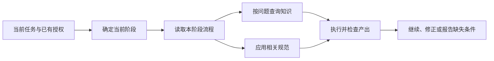

# 知识、流程与规范的边界

维护或重组 agent 指令时，按内容的作用分类；不要仅凭目录名或 `SKILL.md` 文件名决定它的权威与加载时机。Skill 是可发现、按需读取的包装，可以包含多类内容。

| 类别 | 回答什么 | 应写清什么 | 常见落点 |
|---|---|---|---|
| 知识 | 什么成立，为什么？ | 适用版本、前提、事实或假设、证据来源 | `references/`、skill 附件、现有领域资料 |
| 流程 | 在当前任务阶段怎样做？ | 必要输入、动作、可观察产出、何时继续或停止 | `techniques/`、流程 skill 的阶段附件 |
| 规范 | 哪些行为必须或不得发生？ | 来源、适用范围、约束对象、例外和实际执行者 | `guidelines/`、项目约定、宿主与工具边界 |
| 经验 | 某种模型在某类情境下会怎样出错，怎样拦住？ | 一行边界、事故记录、诞生时的模型与日期、最近一次复测 | `guidelines/` 里 `class: experience` 的页面，事故在 `evidence/` |

分类不要求搬动所有旧文件。领域 `guidelines/` 常同时包含事实与条件约束；保留现有可用路径，按章节解释其作用即可。不要为了三分类给每个短文件增加三段空标题或一套元数据。

## 经验随模型过期

知识随世界过期，规范随用户的选择过期，经验随**模型**过期：它补的是某个时期某个模型的缺陷，新模型没有那个缺陷时，补丁就是负担，甚至把模型拉回旧行为。所以经验是唯一一类有效性取决于谁在读的内容，要单独对待：

- 页面只写一行边界加修法，实测故事进 `evidence/incidents/`，页面 frontmatter 用 `incidents` 回指；统计由 `scripts/kb/kb.py index` 生成，页面不手写会过期的次数。
- frontmatter 记 `born`（写下时的模型与日期，没记录就写明）和 `retested`（最近一次用当前模型在干净会话里复测的结果）。复测的问题只有一个：没加载这条规则的模型还会不会犯这种错。还犯留着；一次不犯只进退役候选，不同日期、不同题面下至少两次都不犯才退役成历史记录，事故不删。每轮复测带一道只有读过事故才答得出的对照题，证明探针干净。
- 复测要在干净会话里做：加载了规则的模型对「它有没有拖累我」的判断已经被规则塑造过。

## 知识不能悄悄变成全局命令

- 某框架的 API 前提不是可自由忽略的风格建议。例如某调用必须在对象初始化后执行，这个事实在该调用路径上直接约束实现。
- 事实应保留版本与生效条件；把一条特定版本的限制写成所有项目的禁令，会让知识错误扩大适用范围。
- 经验模式和权衡不是必须采用的架构。示例展示一种解法，不授权 agent 扩大任务或引入依赖。
- 查询知识材料只为解决当前问题，不自动启动其中引用的开发、审批、测试或知识促升流程。

## 流程只管理用户选择的工作

流程入口保持简短：说明何时使用、从哪一步恢复、当前阶段要读哪份材料。阶段细节按需读取；已经知道当前处于验证阶段时，无须再次加载完整设计阶段。

- 一个新阶段只带入所需输入与资料引用；不得用“可能有关”作为全文读取所有附件的理由。
- 保留用户选择的审批点，复用覆盖同一决定的有效授权。引入另一份 skill 不会自动增加审批或要求重跑已有效的验证。
- 任务只是查询、审查、文档或机械修改时，不能仅因流程包里带有实现章节而启动实现、TDD 或重构。
- 多个流程组合时，由当前用户目标和所选流程决定下一步；同一要求只有一个执行者和一份有效结果，不重复叠加清单。
- 没有必要引入新状态系统时，用现有计划或工作记录说明当前阶段、输入和结果即可。短任务可以直接在交付说明中体现这些信息。

## 规范需要来源和生效范围

宿主指令层级决定权限。项目文档、skill 或审查者不能提高自身权威，也不能把建议变成用户已批准的工作。

| 规范来源 | 处理 |
|---|---|
| 宿主或工具限制 | 按实际接口与权限执行，文档不能覆盖 |
| 用户明确约定 | 在其目标、范围和有效期内执行；后续明确修正优先 |
| 项目约定 | 适用于对应项目及行为；冲突按宿主层级和当前用户要求解决 |
| 方法或风格建议 | 按任务价值采用；不自动成为阻塞交付的条件 |

跨所有任务都必要的边界留在根入口；写文件、提交、编译、发布等操作的详细规则在相应操作发生前读取。知识历史、完整案例和阶段脚本不因被称为“规范”就获得常驻理由。

## 文字检查点与真实门禁

`HARD GATE` 写在 Markdown 里，仍然是对 agent 的行为要求；只有实际工具、hook、运行时或 CI 拒绝越界动作时，才有对应范围内的机械门禁。未接入执行机制时，应如实称为文字检查点。

机械门禁也有边界：检查字段存在、类型正确或值等于 `approved`，只能证明检查条件成立，不能单独证明批准来自用户、分类语义正确或交付物满足需求。必须核对输入来源、授权对象和结果证据，不能让 agent 自己填写一个通过值就把它当成独立证明。

是否工程化门禁取决于越界代价、复发情况与现有工具能力；不要为每个普通编码任务新增工作流引擎或审计数据库。保留已验证的宿主与工具防线，不用更长的提示词冒充它们。

## 新增与维护

新增材料先决定它属于哪类内容以及何时需要，再选择位置。入口索引只写任务与路径，技能描述只写触发和排除范围。事实和规范各保留一个主来源；流程引用相关要求，不复制成逐渐变严的另一套版本。

修改后检查入口是否仍可发现、附件在安装包里是否可达、原有用户约束是否保留，以及无关任务是否仍能跳过。文件变短只是静态成本变化；效果改善需要实际任务证据。

这份划分是本仓库的组织方式。Techne-Loom 的案例提供了按节点限定输入、把部分继续条件放进运行时的参考；它没有给出模型能力或 token 成本的对照结果，不能据此声称 Markdown 重组等同于运行时门禁。[参考文章](https://github.com/waynebaby/Techne-Loom/blob/main/docs/zh-cn/articles/skill-unchanged-rules-gated.md)
