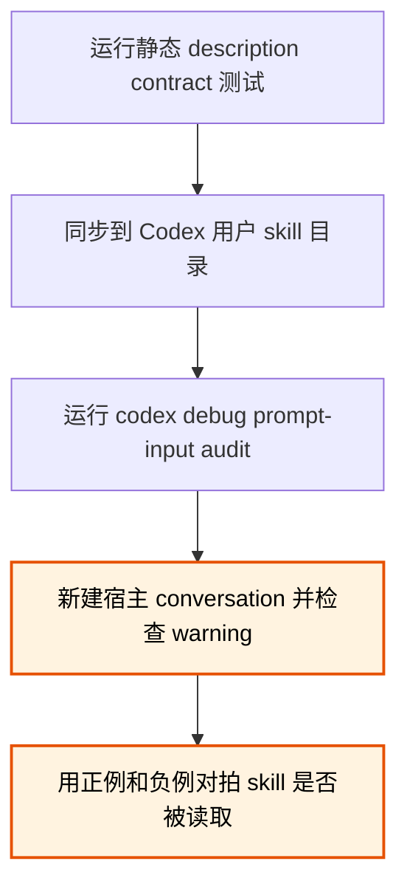

# Skill `description` 触发契约

本文件记录因上下文预算而缩短的 `description` 应维持哪些路由行为。这里的“触发”指 agent 应先读取对应 `SKILL.md`；这些测试输入不是正文答案模板。

## `context-budget-audit`

应触发：

- “审计这个仓库 `AGENTS.md` 导入内容的常驻成本，并判断哪些应转成懒加载。”
- “新建 Codex conversation 时出现 skill descriptions 被缩短的警告，请区分本地 skill 与 host plugin 的贡献。”
- “新增一批 guidelines 后启动变慢、prompt cache 命中下降，请审计 instruction corpus。”

不应触发：

- “降低线上聊天请求本身的 token 消耗。”
- “分析普通 Windows 桌面程序为什么启动慢。”
- “只润色一条 coding guideline；加载策略和上下文大小不在范围内。”

## `ue-custom-graph-editor`

应触发：

- “在 UE plugin 中从零创建带自定义 node、schema 和 toolkit 的 `UEdGraph` 编辑器。”
- “扩展已有 custom graph editor，修复 pin、undo 与 runtime model 不同步。”
- “决定 quest runtime graph、`UEdGraph` pins、connection topology 与 edge metadata 的归属。”

不应触发：

- “给内置 Blueprint editor 增加一个普通 `UK2Node`，不创建新编辑器。”
- “实现没有 editor、schema 或 Slate UI 的 runtime-only graph evaluator。”
- “用普通 Slate widget 显示不可编辑流程图，不使用 `UEdGraph`。”

## `ue-procedural-numerical`

应触发：

- “程序化创建 RigVM nodes 和 links，并给大量 hierarchy elements 投递数据。”
- “把长动画批量烤进 Sequencer 的 Control Rig，逐 key API 太慢。”
- “Optimus deformer graph 重算法线后丢失 imported normals。”
- “在 anim evaluation 外调用 `FRBFSolver` 后出现 `TMemStack` access violation。”
- “在 UE module 接 GPU sparse solver，或给数值 hot path 选择 UE 可用的并行后端。”

不应触发：

- “普通 AnimBP 的 BlendSpace 与 root motion 出现脚滑。”
- “手工连接一个简单 Control Rig 图，问题与程序化建图、批处理或求解无关。”
- “独立 C++ 服务使用 OpenMP 提速，不涉及 UE。”
- “只在 Optimus editor 中整理既有节点布局。”

## `ue-ml-animation`

应触发：

- “用自定义 `UAnimInstance` 和 `FAnimInstanceProxy` 绕过 AnimBP 直接写 pose。”
- “在没有正常 engine loop 的离线工具中评估代码驱动的 skeletal animation。”
- “在 UE NNE 中运行 ONNX，动态 output shape 或 model instance 创建失败。”

不应触发：

- “用普通 AnimBP state machine 实现 idle、walk 和 run。”
- “在外部 Python 服务运行 ONNX，再把 FBX 导入 UE。”
- “在 Unity 中通过 ONNX Runtime 驱动角色。”

## 验证顺序

1. 运行 `scripts/tests/test-skill-description-budget.ps1`。它验证 `description` 的长度、核心路由信号和本文档是否覆盖所有被改 skill。
2. 同步源文件后运行 `codex debug prompt-input audit`，确认 CLI 本地渲染使用新 `description`，且源文本与渲染文本相同。
3. 新建一个宿主 conversation。确认没有 description budget warning，再逐项输入上面的正例与负例。只有本地与宿主两级都通过，才能宣布预算问题已解决；当前 conversation 不会重新注入修改后的 catalog，不能代替这一步。
