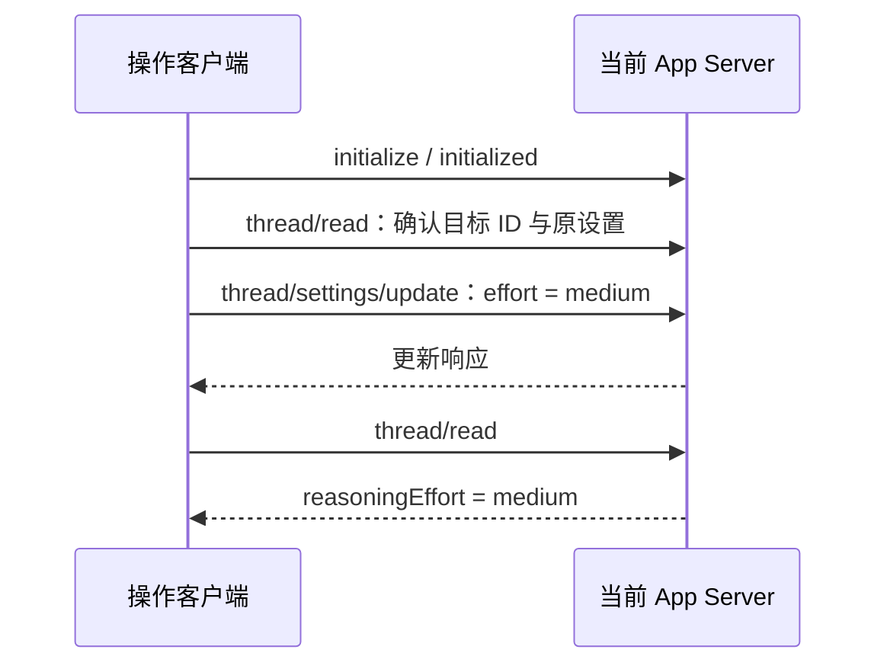

# 调整 Codex 单个会话的推理强度

## 适用范围

用户要求把当前 Codex 对话设为 `medium` 等推理强度，而界面无法调整时，可向承载该对话的本地 App Server 发送 `thread/settings/update`，再用 `thread/read` 回读确认。该操作修改会话后续轮次的设置，不需要轮换 lane，也不修改全局配置。

验证范围：2026-09-13，Windows，本机安装的 `codex-cli 0.154.0`；已执行单会话 `max` → `medium` 并回读确认。其他版本先检查本机生成的协议，不把这里的接口可用性当成所有 Codex 版本的保证。

## 确认目标和连接地址

在目标对话自己的执行环境中读取 `CODEX_THREAD_ID`，缺失时可检查 `CODEX_SESSION_ID`。不要复制另一条对话的 ID，也不要用“最近一条会话”推断目标。确认用户已授权调整该对话。

连接已经运行、承载目标对话的 App Server。Windows 可用下面的只读命令查看进程的监听地址；它只输出 PID 和 `--listen` 值，不打印完整启动参数：

```powershell
Get-CimInstance Win32_Process -Filter "Name='codex.exe'" |
  Where-Object { $_.CommandLine -match 'app-server' } |
  ForEach-Object {
    [pscustomobject]@{
      ProcessId = $_.ProcessId
      Listen = [regex]::Match($_.CommandLine, '--listen\s+(\S+)').Groups[1].Value
    }
  }
```

使用实际的本地 WebSocket 地址，端口不固定。多个实例并存时，先通过 `thread/read` 确认目标对话属于所选实例。下面的示例只覆盖可直接访问的本地 WebSocket；需要认证的部署使用其现有授权连接方式，不降低认证要求。`codex app-server proxy` 默认控制 socket 连接失败，不能证明 WebSocket 实例也不可用。

协议不确定时，运行 `codex app-server generate-json-schema --experimental --out <临时目录>`，检查 `ClientRequest.json`、`v2/ThreadSettingsUpdateParams.json` 和 `v2/ThreadReadParams.json`。无须重启共享 App Server。

## 更新并回读



核心请求如下。`threadId` 必须替换为目标 ID；参数叫 `effort`，回读字段叫 `reasoningEffort`。

```json
{"id":3,"method":"thread/settings/update","params":{"threadId":"<当前对话ID>","effort":"medium"}}
```

可在目标对话中执行下面的 PowerShell 示例。先把 `CODEX_APP_SERVER_URL` 设为上一步确认的地址。示例需要提供全局 `WebSocket` 的 Node.js，已在 Node.js 24 验证；`CODEX_APP_SERVER_URL` 是本示例的输入变量，不是 Codex 自带配置项。

```powershell
$env:CODEX_APP_SERVER_URL = 'ws://127.0.0.1:<实际端口>'
```

```powershell
@'
const threadId = process.env.CODEX_THREAD_ID || process.env.CODEX_SESSION_ID;
const endpoint = process.env.CODEX_APP_SERVER_URL;
if (!threadId || !endpoint) throw new Error('Missing thread ID or App Server URL');
const ws = new WebSocket(endpoint);
const pending = new Map();
let nextId = 1;
ws.addEventListener('message', event => {
  const message = JSON.parse(event.data);
  const slot = pending.get(message.id);
  if (!slot) return;
  pending.delete(message.id);
  clearTimeout(slot.timer);
  if (message.error) slot.reject(new Error(JSON.stringify(message.error)));
  else slot.resolve(message.result);
});
function request(method, params) {
  return new Promise((resolve, reject) => {
    const id = nextId++;
    const timer = setTimeout(() => {
      pending.delete(id);
      reject(new Error(`RPC timeout: ${method}`));
    }, 10000);
    pending.set(id, { resolve, reject, timer });
    ws.send(JSON.stringify({ id, method, params }));
  });
}
try {
  await new Promise((resolve, reject) => {
    const timer = setTimeout(() => reject(new Error('Connection timeout')), 10000);
    ws.addEventListener('open', () => { clearTimeout(timer); resolve(); }, { once: true });
    ws.addEventListener('error', () => {
      clearTimeout(timer);
      reject(new Error('WebSocket connection failed'));
    }, { once: true });
  });
  await request('initialize', {
    clientInfo: { name: 'codex-reasoning-settings', version: '1.0.0' },
    capabilities: { experimentalApi: true },
  });
  ws.send(JSON.stringify({ method: 'initialized' }));
  const before = (await request('thread/read', { threadId, includeTurns: false })).thread;
  if (before.id !== threadId) throw new Error('Thread identity mismatch');
  await request('thread/settings/update', { threadId, effort: 'medium' });
  const after = (await request('thread/read', { threadId, includeTurns: false })).thread;
  console.log(JSON.stringify({ threadId, previousEffort: before.reasoningEffort,
    reasoningEffort: after.reasoningEffort, modelUnchanged: before.model === after.model }));
  if (after.reasoningEffort !== 'medium' || before.model !== after.model) {
    throw new Error('Settings readback mismatch');
  }
} finally {
  for (const slot of pending.values()) clearTimeout(slot.timer);
  ws.close();
}
'@ | node --input-type=module
```

成功判据是回读 `reasoningEffort: "medium"` 且 `modelUnchanged: true`。更新响应本身不含最终字段，不能只看到空对象响应就声称已确认。若后续请求显式指定其他强度，它仍可能覆盖这项会话设置。

## 当前轮次与轮换的区别

`thread/settings/update` 用于后续轮次。正在执行的轮次另有 `turn/settings/update`，需要准确的 `threadId`、`turnId` 和 `effort`。本次实测该接口返回 `turn settings updates require the step_model_switching feature`；这不撤销已经成功的会话设置，应报告“下轮生效”，不要声称当前正在执行的推理已切换。

即使当前轮次更新返回 `applied`，协议也只保证后续读取设置的步骤能获取更新；已经读取旧设置的步骤不变，也不保证该轮还会发起下一次推理。不要为调整强度顺带开启全局实验功能。

Lane Router 是否支持启动强度参数，应以本机 `lane-router-rotate --help` 为准。本次检查的版本只提供 backend、lane 地址、handoff 文件和 terminal 参数，没有独立强度参数。该会话设置也不保证新 generation 的新 thread 自动继承；需要跨轮换延续时，在 handoff 中记录期望值，并让接替对话按本流程设置和验证。lane 操作另见 [Lane Router 手册](lane-router.md)。
