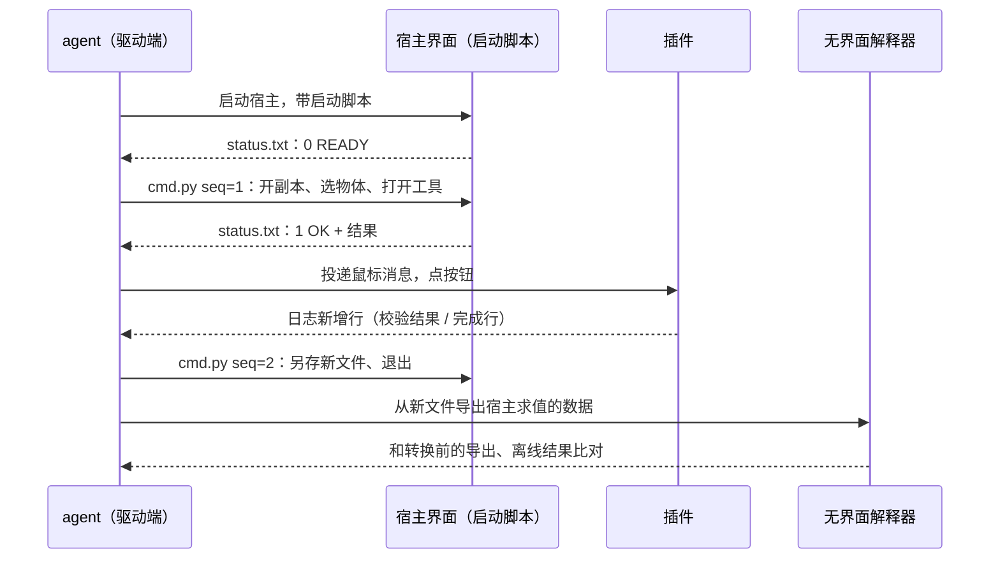

# DCC 插件的真界面端到端自动测试：agent 自己点，别交给用户

## 核心规则

DCC 宿主（MotionBuilder / Maya / Max …）里的 C++ 插件，有一段行为只在**真实宿主界面**里成立：按钮回调、宿主对场景的求值、
写回曲线 / 场景。无界面解释器（`mobupy` / `mayapy`）覆盖得到插件调用的计算库和数据导出，**覆盖不到插件本体**。

这一段由 agent 自己跑，不要把"点几下按钮"交给用户。四件事：

1. **宿主启动脚本 + 主线程命令通道**：一步一步发指令（开文件、选物体、存盘），每一步都看得到结果。
2. **按控件名找按钮，向窗口投递鼠标消息**：插件没有脚本接口也能点；不动真实鼠标、不抢焦点。
3. **完成信号用插件自己的日志行**，开测前先确认宿主加载的是刚编的那份插件。
4. **判据用宿主自己的求值**：另存新文件 → 无界面解释器导出宿主算的数据 → 和转换前的导出、离线结果比。

⚠️ 跟 [`../guidelines/code/gui-visual-machine-gating.md`](../guidelines/code/gui-visual-machine-gating.md) 的边界：那条管
**画面看起来对不对**（交人工）；本条管**入口在界面上、判据却是数据**（矩阵 / 曲线 / 场景属性）的情形 —— 这种可以全自动，
交给人只是把机器能做的活外包了，而且每一轮回归都要再外包一次。

## 流程



### 1. 启动宿主，挂主线程命令通道

- 启动参数带一个 Python 启动脚本（MotionBuilder：`motionbuilder.exe <script.py>`；Maya 的启动方式见
  [`../guidelines/maya/gpu-deformer-gui-validation.md`](../guidelines/maya/gpu-deformer-gui-validation.md)「GUI 启动方式」）。
- 启动脚本注册**界面空闲回调**（MotionBuilder：`FBSystem().OnUIIdle`），轮询一个命令文件：第一行是 `# seq=<N>`，N 比上次大才执行；
  在主线程 `exec`，把 `seq` 和 `OK` / `ERR` 加结果或 traceback **原子地**写进状态文件。
- 驱动端：读状态文件里当前的 seq，写 seq+1 的命令文件（UTF-8 无 BOM，用写文件工具落盘，见
  [`../guidelines/code/generating-code-through-shell.md`](../guidelines/code/generating-code-through-shell.md)），轮询到状态文件的 seq 对上为止，带超时。
- 命令片段就是普通宿主脚本，最后给 `result` 赋值作回报。MotionBuilder 常用的几句：`FBApplication().FileOpen(副本, False)`、
  `ShowToolByName("<工具名>")`、`FBFindModelByLabelName(名字).Selected = True`、`FBApplication().FileSave(新路径)`、`FBApplication().FileExit(False)`。

| 选择 | 理由 |
|---|---|
| 主线程执行 | 宿主 SDK 不保证线程安全；空闲回调本来就在主线程 |
| 文件 + seq，不开端口 | 不引入监听端口和新的进程间协议；seq 保证同一条命令不会执行两次 |
| 分步，不写一次性脚本 | 每步看到结果再决定下一步（例如按钮被插件拒绝时，先读弹窗再决定还点不点下一个） |
| 回调里节流（约 0.5 s） | 空闲回调触发很频繁，每次都读文件会拖慢界面 |

```python
# 宿主启动脚本（MotionBuilder）：空闲回调里轮询 cmd.py，在主线程执行，结果写 status.txt
import os
import time
import traceback

from pyfbsdk import FBSystem

D = r"<命令目录>"
CMD, STATUS = os.path.join(D, "cmd.py"), os.path.join(D, "status.txt")
STATE = {"last": 0, "t": 0.0}
G = {"__name__": "harness_cmd"}
exec("from pyfbsdk import *", G)


def write_status(seq, text):
    tmp = STATUS + ".tmp"
    with open(tmp, "w", encoding="utf-8", newline="\n") as f:
        f.write("%d\n%s\n" % (seq, text))
    os.replace(tmp, STATUS)  # 原子替换：驱动端不会读到半个文件


def on_idle(control, event):
    if time.time() - STATE["t"] < 0.5:
        return
    STATE["t"] = time.time()
    try:
        with open(CMD, encoding="utf-8") as f:
            src = f.read()
    except OSError:
        return
    first = src.split("\n", 1)[0]
    if not first.startswith("# seq="):
        return
    seq = int(first[len("# seq="):])
    if seq <= STATE["last"]:
        return
    STATE["last"] = seq
    G["result"] = ""
    try:
        exec(compile(src, CMD, "exec"), G)
        write_status(seq, "OK" + chr(10) + str(G["result"]))
    except Exception:
        write_status(seq, "ERR" + chr(10) + traceback.format_exc())


FBSystem().OnUIIdle.Add(on_idle)
write_status(0, "READY")
```

### 2. 点没有脚本接口的按钮

- 用 Windows UI Automation：按进程 id 找宿主的窗口，再在工具窗口里**按名字**找控件，取包围框中心点。
- 点击：从工具的顶层 HWND 开始，用 `ChildWindowFromPointEx` 一路找到该点所在的最深子窗口，向它 `PostMessage`
  `WM_MOUSEMOVE` / `WM_LBUTTONDOWN` / `WM_LBUTTONUP`（坐标换成该窗口的客户区坐标）。**不动真实鼠标，也不要求窗口在前台**，
  用户可以照常用电脑。
- **不要在驱动端同步调用 UIA 的 `InvokePattern.Invoke()`**：按钮回调里一弹模态框，`Invoke` 就一直等到弹窗关掉才返回，
  驱动端整个卡住。非用不可就放到另起的进程里调。
- 插件弹出的模态框：按进程 + 窗口类名和标题找，用 `PrintWindow` 截图（被别的窗口挡住也截得到），用 UIA 读文字、找 `OK` 点掉。

```csharp
// 经 PowerShell Add-Type 编译使用。从 top 往下找到屏幕点 (sx, sy) 所在的最深子窗口，投递一次左键单击
using System;
using System.Runtime.InteropServices;
public static class PostClick {
    [StructLayout(LayoutKind.Sequential)] public struct POINT { public int X; public int Y; }
    [DllImport("user32.dll")] static extern bool ScreenToClient(IntPtr h, ref POINT p);
    [DllImport("user32.dll")] static extern IntPtr ChildWindowFromPointEx(IntPtr h, POINT p, uint flags);
    [DllImport("user32.dll")] static extern bool PostMessage(IntPtr h, uint msg, IntPtr w, IntPtr l);
    public static IntPtr Click(IntPtr top, int sx, int sy) {
        IntPtr h = top;
        while (true) {
            POINT c; c.X = sx; c.Y = sy; ScreenToClient(h, ref c);
            IntPtr k = ChildWindowFromPointEx(h, c, 1 /* CWP_SKIPINVISIBLE */);
            if (k == IntPtr.Zero || k == h) break;
            h = k;
        }
        POINT q; q.X = sx; q.Y = sy; ScreenToClient(h, ref q);
        IntPtr lp = (IntPtr)((q.Y << 16) | (q.X & 0xFFFF));
        PostMessage(h, 0x0200, IntPtr.Zero, lp);  // WM_MOUSEMOVE
        PostMessage(h, 0x0201, (IntPtr)1, lp);    // WM_LBUTTONDOWN（MK_LBUTTON）
        PostMessage(h, 0x0202, IntPtr.Zero, lp);  // WM_LBUTTONUP
        return h;
    }
}
```

### 3. 完成信号，以及"测的是不是刚编的那份"

- 插件有日志就用日志：动作前记下行数，动作后只读新增的行，等固定的完成行（例如 `FinishRun:`），带超时。
- 开测前读日志里的版本和构建时间，确认宿主加载的是刚编的插件。宿主的插件目录多在 `Program Files` 下：拷新插件要管理员权限
  （一次 UAC），宿主开着时插件文件被锁、拷不进去 —— 拷贝静默失败的话，测的就是旧插件，而结果看起来一切正常。
- 构建时间若取自某个源文件的 `__DATE__ __TIME__`，只在**那个文件**重编时才刷新；只改了别的文件时它停在旧值。
  ⇒ 再比一次部署后的插件文件和刚编出来的是否同一个哈希。

### 4. 判据用宿主自己的求值

- 用副本打开，存成新文件；再用无界面解释器从新文件导出宿主算出的数据（例如每帧世界矩阵），和转换前的导出、离线求解结果比。
- 不拿插件日志或插件内部的数当判据：插件算错时，它自己的数跟着错。宿主的求值是插件控制不了的判官
  （[`adversarial-verification.md`](adversarial-verification.md)「判据在因果上独立于生产者」）。
- 测完用命令通道让宿主退出（MotionBuilder：`FileExit(False)`），只结束自己启动的进程。

## MotionBuilder 2023 实测的隐藏约束

| 约束 | 后果 / 修法 |
|---|---|
| C++ `FBTool` 的按钮在 UIA 里**以 `AddRegion` 的 region 名命名**（如 `AddNodeButton`），不是按钮上显示的文字，控件类型也不是 Button | 按 Button 类型筛一个都找不到；按 region 名找。region 名去插件源码里查 |
| UIA 树里工具窗口挂在主窗口 `Mainboard` 下，但 Win32 层它是**独立的顶层 HWND**，标题等于工具名 | 投递消息要从 `FindWindow(null, 工具名)` 拿到的 HWND 往下找，不能从主窗口找 |
| PowerShell 把 `$null` 传给 P/Invoke 的 `string` 参数时会变成空串 | `FindWindow` 第一个参数要传 `[NullString]::Value`，否则找不到窗口 |
| 插件弹的模态框是标题等于工具名的 Qt 窗口（类名 `Qt5152QWindow`） | 按进程 + 类名 + 标题找；`PrintWindow` 截图 |
| 宿主打开文件时，会把内嵌的媒体解出到文件旁边 | 永远打开副本，原件不动 |
| C++ `FBTool` 的 `FBCreate` 要到工具第一次被打开时才调用，不是插件加载时 | 插件若在 `FBCreate` 里初始化日志，打开工具之前读到的还是上一次会话的日志；版本行要在打开工具之后读 |

## 行为面：说"测不了"之前，先查自己做过什么

harness 搭在会话临时目录里，上下文压缩后的摘要不一定带上它。实测一次：agent 看不到自己搭过的工具，就以"插件只有界面按钮"为由
说"测不了"，把测试交给用户；用户一句"你之前不是自己测过吗"才打破。

- 说"做不到 / 测不了"之前，先列一下本会话的临时目录和产物目录。这是
  [`../guidelines/code/reporting-limits-and-null-results.md`](../guidelines/code/reporting-limits-and-null-results.md) 规则 3
  （我能看到的范围 ≠ 全部范围）在会话层面的一个面。
- 要跨会话复用，就把 harness 收进项目仓库的工具目录，或在项目 memory 里记下重建要点 —— 会话临时目录随会话消失。

## Anti-Patterns

| 反 pattern | 后果 | 修法 |
|---|---|---|
| 插件只有界面按钮 ⇒ 让用户来点 | 机器能做的验证外包给人，每轮回归都要再外包一次 | UIA 按名字找控件 + 投递鼠标消息 |
| 驱动端同步 `Invoke()` 点按钮 | 回调弹模态框时驱动端卡死 | 投递鼠标消息，或在另起的进程里 Invoke |
| 用 `SendInput` / 移动真实鼠标去点 | 抢用户的鼠标和焦点；窗口被挡住就点到别处 | 消息直接投递到目标窗口 |
| 不确认构建时间就开测 | 拷贝静默失败时测的是旧插件，结果看起来正常 | 先读日志的版本行 |
| 拿插件自己输出的数当判据 | 插件错，判据跟着错 | 宿主求值，导出后比 |
| 直接打开用户给的原文件 | 宿主在旁边解出媒体文件；误存会覆盖原件 | 副本 |

## 诚实边界

- 通用流程（agent 自己驱动真实宿主界面，判据不交给人）**跨 2 个项目**：Maya GPU deformer 插件（一次性 fixture 形态，见上面链接的 Maya 篇）
  和一个 MotionBuilder 工具插件（本文的分步命令通道形态）。
- "按控件名找按钮 + 投递鼠标消息"**只在 MotionBuilder 2023、一个插件、两轮测试里用过**。Maya / Max 的 Qt 控件在 UIA 里的名字是否同样查得到，
  未验证；只适用于 Windows。
- 行为面那一条是单次实例。
- 整体 apply-and-refine。

## 相关 Guidelines / Techniques

- [`../guidelines/maya/gpu-deformer-gui-validation.md`](../guidelines/maya/gpu-deformer-gui-validation.md) —— Maya 的真界面验证：启动方式、进程与结果判定、GPU 四重证据
- [`../guidelines/code/gui-visual-machine-gating.md`](../guidelines/code/gui-visual-machine-gating.md) —— 画面正确性交人工；本条管判据是数据的那部分
- [`adversarial-verification.md`](adversarial-verification.md) —— 判据独立于生产者
- [`../guidelines/code/reporting-limits-and-null-results.md`](../guidelines/code/reporting-limits-and-null-results.md) 规则 3 —— 说"没有 / 做不到"之前先问可达范围
- [`../guidelines/code/generating-code-through-shell.md`](../guidelines/code/generating-code-through-shell.md) —— 命令片段用写文件工具落盘
