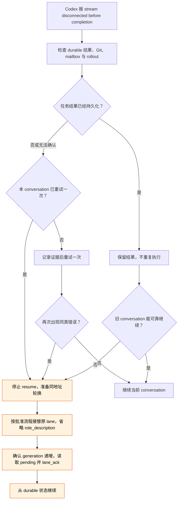

# Codex 响应流断开后的 Lane 恢复

## 结论

`stream disconnected before completion` 是 Codex 响应流或结束状态异常，不是 Lane Router 的任务状态。它不能证明任务未执行、lane 没在工作或 durable 结果不存在。先取证，最多在原 conversation 重试一次；同类错误再次出现时，停止连续 `resume`，按批准流程轮换到同一 lane 地址。

## 为什么要先检查结果

一次实测中，Codex 已经写出完整评审结果和最终回复，随后 `task_complete` 仍记录为 `codex_error_info: "other"`；在同一旧 conversation 中继续 `resume` 又得到新的 request ID 和同类错误。客户端证据不能确定服务端根因，只有 OpenAI 能用 request ID 追踪内部请求。

不要把这个错误与 `Selected model is at capacity`、rate limit 或 context window 超限合并判断。它们有各自的明确证据；没有对应证据时，只能报告“响应流断开”。同理，`lane_directory` 的 reachability、旧进程仍存在、消息仍在 `pending`，都不能单独证明 lane 正在工作或已经停止。

## 恢复流程

1. 先检查任务是否已经产生 durable 结果，包括目标文档、评审报告、commit、测试输出、worklog 和 mailbox 回复。若结果存在，先保存其精确路径和 hash，不要因为终端报错就重做。
2. 读取对应 rollout 的最后事件，区分“没有生成结果”和“已经生成结果，但 `task_complete` 结束异常”。同时记录 UTC 时间、thread ID、turn ID、request ID、Codex CLI 版本、模型、context/token 读数和 rate-limit 读数。向 OpenAI 报障时提交这些证据，不提交项目 secret 或完整私人 session 日志。
3. 同一 conversation 最多重试一次。若重试仍以新的 request ID 报同类错误，停止连续 `resume`；旧 conversation 的尾部状态已经不能作为可靠工作入口。
4. 需要轮换时，仍遵守 [`lane-router.md`](lane-router.md) 的接替流程：用户在目标 conversation 明确确认；新 conversation 接替完全相同的 lane 地址且不修改 `role_description`；确认 binding generation 递增；恢复原 cwd、Git 和 handoff；逐个读取全部 `pending` `.md`，只 ack 已处理的 ID。
5. 轮换期间不要创建替代 lane、改变其他 binding、清理 mailbox 或把旧 lane 的沉默写成“未工作”。新 binding 报告接替成功之前，也不要把轮换记为完成。

## 降低再次发生后的损失

不要把同一 notification 或 message ID 反复手工注入 conversation。notification 是索引，不是新任务；按 `pendingPath` 读取一次正文，完成后 ack。繁忙 turn 临近结束时也不要为了查询状态连续追加相同提示。

长任务在自然 checkpoint 先写 durable 结果和精简 handoff。主动轮换一组 lane 时，仍使用 [`role-lane-coordination`](../skills/collaboration/role-lane-coordination/SKILL.md) 的三项可观察判据，不使用不可观察的 context 百分比阈值。
