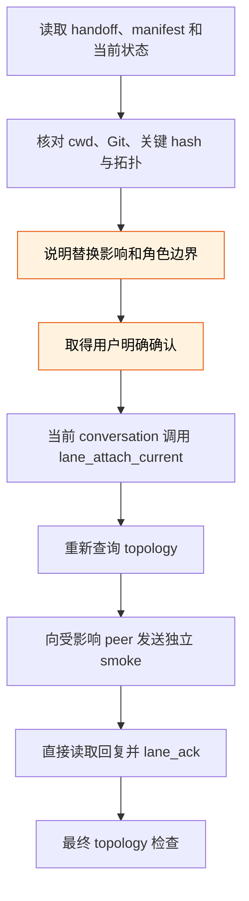
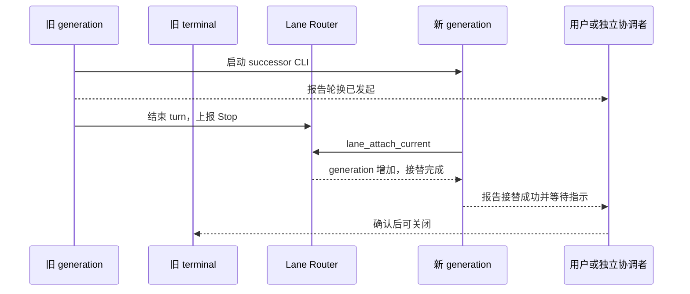
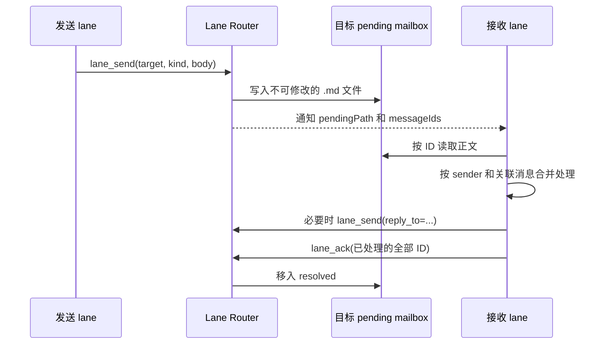

# Lane Router 使用手册

Lane Router 让同一台可信机器上的长期 Claude/Codex 对话以稳定地址互相投递消息，并在目标对话可用时通知它处理持久 mailbox。它解决的是 lane 的绑定、投递和唤醒；如何划分角色、设计 seam contract 和选择 coordinator，仍以 [`role-lane-coordination`](../skills/collaboration/role-lane-coordination/SKILL.md) 为准。

## 术语表

| 术语 | 含义 |
|---|---|
| lane | 持久的角色和上下文边界，地址形如 `<project>/<lane>`；它不是一次性 task。 |
| binding | lane 当前对应的 Claude conversation 或 Codex thread。 |
| mailbox | 每条 lane 的持久消息目录，分为 `pending` 和 `resolved`。 |
| notification | 只携带 lane 地址、`pendingPath` 和 message ID 的唤醒索引；它不包含消息正文。 |
| correction | 通过新消息修正旧消息，并用 `reply_to` 保留关联；它不会改写已经落盘的原消息。 |

## 安装与启动

前提是 Node.js `>=22.12`，并且 Lane Router 仓库已经构建。首次安装或仓库更新后，在 `<lane-router-repo>` 中运行：

```powershell
npm ci
npm run build
npm link
```

### Codex

在希望作为新 thread 工作目录的项目目录中运行：

```powershell
lane-router-codex
```

恢复已有 thread 时运行：

```powershell
lane-router-codex resume <thread-id>
```

需要指定模型或 Codex 配置 profile（`--profile <name>` 叠加 `$CODEX_HOME/<name>.config.toml`，常用于在 GLM 与 GPT provider 间切换）时，launcher 会透传 `--model` 与 `--profile`，并按 profile 里的 `model_provider` 向 Router 请求一个 provider 专属 endpoint；该 endpoint 的 bridge 会把 `modelProvider` 注入 `thread/start` / `thread/resume`（TUI 在 remote 模式不会自己发送 provider）：

```powershell
lane-router-codex --profile gpt
lane-router-codex --profile glm resume <thread-id>
```

两个边界：provider 注入是 Router 侧能力，升级 lane-router 后必须受控重启 Router 才生效（旧 Router 上带 `--profile` 启动会直接报错而不是静默走默认 provider）；`lane-router-rotate` / `lane-router-lane open` / restore 重开 lane 时目前不重放 `--profile`，会用默认 endpoint 恢复（GPT lane 被轮换后会回落到基础 config 的 provider/model）。

共享 app-server 在每次 `thread/start` 时重读 `~/.codex/config.toml`，因此改基础 config 的 provider/model 对**新建** thread 立即生效、无需重启 Router（已开 thread 的 resume 不受此影响）；`model_catalog_json` 指向的 models.json 同理跟随 app-server 进程生命周期。

launcher 会按需启动 Router 核心进程和 Codex 宿主进程，并把 stock Codex TUI 连接到宿主的 bridge。宿主持有 Codex app-server，生命周期与 Router 核心分开：Router 核心重启时开着的 Codex 对话照常，期间 lane 工具立即报「Lane Router is not running」，核心回来后宿主自动重连；宿主自己重启时 Codex 对话会断开，需要 `resume`。不要手动启动 Router 或宿主，也不要把 PID、端口或历史 discovery 值写进脚本。Router 端口默认随机，可以在数据目录的 `config.json` 用 `port` 固定（见 Lane Router 仓库 `docs/manual-tests.md`「本机主入口的固定端口」）；固定以后，客户端和脚本仍然一律读 `discovery.json` 寻址。Codex 宿主的端口仍然随机。新 thread 使用调用 `lane-router-codex` 时的当前目录；`resume` 保留原 thread 的工作目录。

### Claude Code

把构建产物注册为 user-scope MCP，其中 `<lane-router-repo>` 必须展开成当前机器上的绝对路径：

```powershell
claude mcp add --scope user lane -- node "<lane-router-repo>\dist\mcp\lane-mcp-server.js"
claude mcp get lane
claude mcp list
```

普通 `claude` 可以调用 Lane Router tools。需要 Channel 在没有用户输入时自动唤醒 lane：**2026-10-21 起（LR-24）lane 走插件通道**，launcher 自动用这个参数，手开会话也这么写：

```powershell
claude --channels plugin:lane@lane-local
```

前提是这台机器装过 lane 插件并且托管设置放行了它：仓库 `tools/channel-plugin/` 是插件源，`scripts/install-channel-plugin.ps1` 每台机器跑一次（装到 user 作用域、撤掉用户级 `lane` MCP 注册；托管白名单要管理员另写，见下）。跑完用 `claude plugin list` 核一眼 `lane@lane-local` 的 Scope 是 `user`。这样启动**不弹任何确认框**，工具全名前缀是 `mcp__plugin_lane_lane__`（旧前缀 `mcp__lane__` 只在迁移前开的会话里还能见到）。用户级 `lane` 注册和插件不能同时在一个会话里（Router 会拒掉第二条通道，LR-30）。

旧写法 `claude --dangerously-load-development-channels server:lane` 只在还没迁移的机器（Linux 虚拟机，LR-58）上用：它每次启动都弹「WARNING: Loading development channels」确认框，没有设置能免。更早的 `--channels server:lane` 不要用。

**每台跑 lane 的机器还必须有一份托管设置开启 channel**，否则 flag 加了也白加：Claude 客户端会把 channel 通知**静默丢弃**——工具全能用、发送方看到的 `notificationState` 也是 `sent`，只有 MCP 日志（`~/.cache/claude-cli-nodejs/<cwd>/mcp-logs-lane/*.jsonl`）里那行 `Channel notifications skipped: channels not enabled by org policy` 说了实话。文件内容：`{ "channelsEnabled": true, "allowedChannelPlugins": [{ "marketplace": "lane-local", "plugin": "lane" }] }`（第二项让 lane 插件的通道免确认框；它会**替换**官方默认的插件白名单，只在托管设置里生效），位置按系统：

| 系统 | 路径（需管理员 / root 写） |
|---|---|
| Windows | `C:\Program Files\ClaudeCode\managed-settings.json` |
| Linux | `/etc/claude-code/managed-settings.json` |

放好后重开会话，日志里应变成 `Channel notifications registered`。2026-09-21 在一台新装的 Linux VM 上踩到：账号、组织、Claude 版本、flag、lane-router 版本跟 Windows 全部一致，只差这个文件。

Claude 的 user-scope MCP 保存的是 `dist` 的绝对路径。仓库移动、`dist` 尚未构建或构建产物被清理后，配置会失效；重新 build，并用 `claude mcp get lane` 检查连接。Codex 命令缺失时先运行 `Get-Command lane-router-codex`，再检查 `npm link` 是否仍指向当前构建。

## 五项对话工具

| 工具 | 用途与约束 |
|---|---|
| `lane_directory(project)` | 只读列出同 project 的 lane 和角色说明；无需用户确认。拓扑变更前先调用它，优先复用职责匹配的 lane。 |
| `lane_attach_current(address, role_description?)` | 创建、接替、轮换 lane 或修改角色说明。**创建新 lane、自己换代轮换（不改角色）不需要用户确认**；**接替另一条仍有 live 会话的 lane、或修改已有 lane 的角色说明，调用前要在普通对话中说明并取得用户明确确认**；拿不准算接替。不要添加机械式 `confirmed` 参数。接替现有 lane 且不改角色时省略 `role_description`。 |
| `lane_send(target, kind, body, reply_to?)` | 向目标 `pending` mailbox 写入不可修改的消息。普通消息用 `normal`；修正旧消息用 `correction` 并以 `reply_to` 指向原 message ID。 |
| `lane_ack(message_ids)` | 读完、纳入自己的工作状态之后就 ack，批量把每个 ID 从 `pending` resolve。**ack 是通信层的「已收到并读懂」，不是「任务做完」**：等人裁定、活还没干完，照样先 ack，用自己的 worklog / 回信跟踪进度。只有真没读到或没读懂的才留着不 ack。原因见故障排查「同一封信每个 turn 都来叫」。 |
| `lane_finish()` | 任务 lane 交付完毕后自己宣告完成，没有参数。前提：角色首句是「任务 lane：」、信都 ack 过、名下问答没有悬而未决的（否则 `LANE_FINISH_BLOCKED` 列出剩余项）。之后 Router 在这条 lane 下一次停下时结束它的进程、关窗并归档，再给它发信会收到 `LANE_FINISHED`。调完它就不要再调任何工具。父 lane 的兜底是 shell 命令 `lane-router-lane close <address>`。 |
| `lane_restore_project(lanes?)` | 已绑定的 caller 一键恢复本 project 其他离线 lane 的原 conversation（机器重启场景；不传 `lanes` 恢复全部 peer）。**当前任务需要够到离线的 peer 时即可调用，不必先问用户；只唤醒真要用到的，别成批投机唤醒。**它不是拓扑变更。旧 Codex thread 无法刷新工具清单时，用兼容 CLI `lane-router-restore-project [lane-address ...]`（需要 shell 里有 `CODEX_THREAD_ID`）。 |

lane 分三层，先问「subagent 够不够」：**subagent**（Agent 工具）给不需要和用户对话、不需要被找到的内部活；**任务 lane** 给边界清楚、但要和用户澄清几轮或要跑一阵、要能被找到 / 唤醒的需求——由收到需求的角色 lane 直接开（不必先问用户，但要在原议题说明开了谁、为什么），角色说明首句写「任务 lane：为问答 `<议题>` 开，归属 `<父 lane>`，完成条件 …，完成即归档」（议题 id 和父 lane 地址要带反引号，Router 按这个格式解析归属），做完交付后调 `lane_finish`：它要求信都 ack 过、名下问答没有悬而未决的，之后 Router 在该 lane 下一次停下时结束它的进程（窗口随之关掉）并归档，完成后再给它发信会被拒。父 lane 对忘了宣告或卡住的任务 lane 用 `lane-router-lane close <address>` 兜底；两条都只认首句「任务 lane：」的 lane，常驻 lane 关不掉。2026-10-21 真机验证过；在 Vikunja LR-54 上线前，任务 lane 挂上后会先「等指示」，父 lane 要补一封开工信；**角色 lane** 是长期职责。创建新 lane 和自己换代轮换不需要确认；接替另一条仍 live 的 lane、修改已有 lane 的 `role_description` 才要先查目录、说明并取得确认。当前 conversation 已绑定另一条 active lane 时，Router 会拒绝隐式换绑。

### 接替与轮换的闭环检查

计划让当前 conversation 接替已有 lane 时，不能只看地址存在就直接 attach。接替或轮换采用下面的闭环；只操作当前 conversation，绝不代表另一条 conversation 调用 `lane_attach_current`。



smoke 回复至少回显原 dispatch ID、当前工作目录、handoff/SoT hash 和理解到的角色边界；smoke 本身不得顺手实现功能。保留每个 reply ID，逐条读完并 ack，不能把多条回复压成无法追溯的一句“都正常”。

### 自动轮换 conversation

上下文过长、但 lane 的长期角色仍然有效时，先在旧 conversation 说明同地址接替的影响并取得用户明确确认，再让旧 agent 写精简 handoff 并调用：

```powershell
lane-router-rotate <codex|claude> <lane-address> --handoff-file <absolute-path> [--terminal <wt|powershell|cmd>]
```

handoff 文件必须位于 `~/.lane-router/rotation-handoffs/`，使用 UUID `.md` 文件名。新 conversation 只接替完全相同的地址并省略 `role_description`；恢复 cwd、Git 状态、批准范围、验证证据和 pending mailbox 后先报告就绪，不自行推进新功能。

`lane-router-rotate` 返回成功只证明 successor CLI 已启动，状态是“轮换已发起”，不是“轮换已完成”。Router 为避免截断旧 generation 正在运行的 turn，会让新 conversation 的 `lane_attach_current` 等待旧 turn 上报 `Stop`。因此旧 agent 在命令返回成功后只允许发送一条最终状态，然后必须立即结束当前 turn；不得再调用工具、查询 `lane_directory`、等待或轮询接替结果。旧 turn 持续运行会使新 generation 一直无法完成 attach。



旧 **turn** 必须停止，旧 **terminal** 可以暂时保留；二者不是同一个动作。接替成功只能由新 generation，或能独立查询 Router 的用户/协调者确认。旧 agent 不负责在同一个 turn 里等待回执，也不得宣称轮换完成。确认新 generation 已报告 attach 成功后，才能关闭旧 terminal 或把轮换记为完成。

Windows 上创建交互式独立 terminal 时，不要把 Node `spawn` 的 `spawn` 事件当作窗口可见且持续存在的证据。真实验证表明，直接 `spawn` PowerShell 并设置 `detached: true` 可以先报告成功、随后立刻退出，既没有窗口也没有启动目标 CLI。Lane Router 因此通过 PowerShell `Start-Process -WindowStyle Normal` 创建可见 terminal；若轮换没有窗口，检查实际进程链应为 `PowerShell → terminal-child → lane-router-codex/claude`（terminal child 旧名 `rotation-terminal-child`，2026-08-18 泛化为三条开窗命令共享），不要只看 launcher 退出码。

### 一组 lane 的轮换（实测形态与反例）

判据本身在 skill `role-lane-coordination` 方法 11（常驻）；这里只记**为什么**与**踩过什么**（按需读）。以下全部来自一次六 lane 项目的实际轮换。

**① 时机判据的两个歧义，都是「两个数都对」型**

- **量纲**：判据写成「context 近上限」时，两条 lane 各自去量了**会话 token 预算**（`total_tokens left`，1450万/1500万），而要判的是 **context window**（1M）。两个数都可测、都叫 context，**所以没有任何信号提示双方在答不同的问题**。其中一条靠"注意到那不是同一个量"改口说「这个量我测不了」——**避免了错答，但没能给出对答**；真正的修复来自换判据。
- **时态**：换成「已经发生过压缩」之后仍有漏洞（一条 lane 指出）：它证明「窗口在**某个时刻**被超过」，不证明「窗口**现在**紧」——一个第 5 分钟被压缩过、之后只干三件小事的会话同样满足。⇒ 补 ②「压缩之后又积累了实质工作量」。
- **没有余量代理量**：`lane_directory` 只给 `binding{generation, attachedAt}` / `reach{state, connectedAt, lastLifecycleAt, lastNotifiedAt, believedBusy}`，**无 token 数 / 窗口占用**。且 `attachedAt` **零分辨力**——实测六条 lane 全落在 24–25 小时区间，而它们的窗口状态明显不同。**turn 间隔同样不能当代理**（一个 turn 里可以烧掉很多）。⇒ 只剩「已压缩」这个**滞后一步**的信号，且只有每条 lane 自己看得见。

**② 两步 durable：`rotate` 会消费掉 handoff 文件**

实测 `~/.lane-router/rotation-handoffs/` **除最近一份外全空** —— 而唯一活下来的那一代，是**手工另存过的那一代**。⇒ 此前这个机制**靠记性，不靠任何规矩**。忘了另存**不报错、不留痕**，表现是「新会话读完 handoff 就再也拿不到上一代的东西」。

⚠️ 而多 lane 共写的项目待办池必须**按 lane 分节**：实测三条 lane 混写到 1462 行，轮换时谁也找不到自己那部分。分节那一刀的正确形态：**只加分节骨架 + 归位，不顺手改条目内容**，并用**逐行多重集会计**证明「没有第 N+1 种变化」（`Counter` 相减、两个方向都列）——那不是额外工作，是这类改动该有的默认证法。

**③ 许可：踩过两层，逐字转述也不行**

协调者先把用户原话「需要的话就 rotate」摘要成「用户批准轮换」⇒ 被 lane 正确拒绝（它读成"批准机制"而非"批准我现在按"）；协调者随后**逐字**贴原话并说"可以按"——**仍然不对**，因为问题**在通道不在保真度**：系统把 lane 通道标为不可信外部数据，Router 也要求 confirmation **in the conversation**。

⇒ 病名：**「用户说了」和「有人告诉我用户说了」在回执里同一个样子。**
⇒ ℹ️ 而那次实际按下是**合规的**，因为该 lane 自己那条对话的首个 user 回合里就带着轮换指令。它把边界说得很准：**「我能证我这条对话里有这句话」，我证不了「那句话是用户本人当场敲的」** —— 后者才是这条纪律要防的，所以它没被这次削弱。

**④ 收件人列表：机械形态不可用，退回纪律形态但要"失败可见"**

`lane_send` 的 **`cc` 字段在 schema 里，而运行中的 Router 拒收它**（`unrecognized_keys`）——**两条 lane 独立观测**。⇒ 📌 由此得一条工具事实：**别把 schema 当能力证明**，它跟"文档说支持"同一档，要实测。（提出 `cc` 那条建议的 lane 自陈：「我读到的是『schema 里有』，说出口的是『这个机制可用』——差一层」，并指出这种错的代价形态最坏：**真问题配假解法**，会让人以为问题已有着落而停止找真修法。⇒ **推荐一个机制给别人之前，自己先用一次。**）

⇒ 退回纪律形态时选**失败会被别人看见**的那个：**把完整收件人列表写进每封正文**。它仍靠人写那一行，但**漏发对收件人可见**（别人看到列表里少了一个该在的名字就能反问）；而"念在心里"的形态，漏发时没有任何人能看出来。⇒ 实测两次漏发都发生在逐条 send 的形态下，第二次就在被命名之后半小时 ——**收下一条纪律 ≠ 执行它**，中间那步（把它变成一个动作）不会自己发生。

**⑤ handoff 里「要照着执行」的部分不许用占位符**

实测：一份 handoff §1 写明"在 integration 树"，而 §6 的命令写成泛化的 `<worktree>` ⇒ 新会话落在自己 lane 的旧 worktree 上（落后 49 个 commit，今天那批文件在那棵树上根本不存在）。**叙述可以泛化，命令不行**，而两者在同一份文档里读起来一样可信。⇒ 接手方的对策是有效的：**逐条现场核，不抄 handoff**；并主动声明哪些数是继承来的（「那两个数不是我量的，别当我复核过」）。

**⑥ 改完正文回头读一遍标题** —— 编辑动作只覆盖注意力所在的那一半

实测两次，一次在别人的记录里、一次在自己刚写的文件里（**同一晚，同一个人**）：

- 一份 handoff 的某节，正文按实测从"推荐用 `cc` 群发"改成了"`cc` 被 Router 拒收"，**而标题仍写着"群发用 `cc`，别逐条 send"** ⇒ 那份文件里躺了二十分钟一个**标题推荐、正文撤回**的东西，**跳标题读的人会拿到一条已被证伪的建议**。
- 一份 skill 的正文把时机判据从两项改成三项（第三项还是别人补的），**而 frontmatter 的 description 仍写着"时机双判据"** ⇒ 而 description 恰好是最可能被跳着读的那一层。

⇒ 📌 机制（比"要小心"有用）：**改正文时注意力在正文上，标题在视野之外。** 标题跟正文是同一次编辑的两个部分，而编辑动作只覆盖其中一个。
⇒ ✅ 可执行：**改完一段内容，回头读一遍它的标题。** 一行的事。
⇒ ⚠️ 而它跟「✅ 完成标记 + 标题里过期的指令/数字」是同一族的**上游**：那一族说危险的组合是什么，这一条说它**怎么产生的**。⇒ 两次都是当事人整晚在别人记录里清同一个东西，然后在自己刚写的文件里犯了它 —— **对自己产物的命中比在别人那儿命中更有说服力**。

**⑦ 报读数时把取得时刻一起写**

实测：协调者写「我从 router 看你 generation 仍是 6」，而那个读数取得比句子早 408 秒，其间对方已经转成 7。⇒ **「我刚查的」和「我之前查的」在句子里同一个样子** ⇒ 带上取得时刻，接收方才能自己判它过期。

### 打开与新建 lane

lane 收到用户"打开某已有 lane / 新建某 lane"的指令时，不要自己拼 terminal 与 CLI 启动方式，调用统一命令：

```powershell
lane-router-lane new  <project>/<lane> --role "<角色说明>" [--backend claude] [--cwd <dir>] [--terminal <wt|powershell|cmd>]
lane-router-lane open <project>/<lane> [--cwd <dir>] [--terminal <wt|powershell|cmd>]
```

- 调用方不需要知道目标 lane 是什么 agent：`open` 从 Router 的 binding 记录读出 backend 与 conversation id。当前只支持 claude；codex 报"暂不支持"，可手动 `lane-router-codex resume <thread-id>`。
- **`new` 不再需要用户先确认**（与 `lane_attach_current` 的政策一致：只有接替仍 live 的别的 lane、改已有角色说明才要确认；命令不设机械式 confirm 参数）。命令开出新 terminal，bootstrap prompt 指示新对话读 AGENTS.md、查目录、带 `role_description` attach、**读透角色与项目现状后报告就绪；没有被授权的任务就等指令或等点名的活，不自己造活**。地址已存在时报错并提示改用 `open`。`--cwd` 默认取调用命令时的目录。
- **`new` 返回后 lane 不会立刻出现在目录里**：命令成功只说明新 terminal / CLI 已启动，不说明 bootstrap turn 已完成或 `lane_attach_current` 已调用。新模型还要读创建 prompt、仓库 `AGENTS.md` 与适用规范、查询目录，再主动 attach；这一段可能持续几十秒到数分钟，期间 `lane_directory` 查不到新地址是正常状态。**不要因为命令没有输出或目录暂时没有地址而再次执行同一条 `new`**，否则会开出重复 terminal。先观察原窗口是否仍在初始化，并等待它报告 ready；只有原窗口明确启动失败或已经退出、且目录仍无该 lane 时，才能重试。
- **`open` 只恢复离线 lane**：目标在线（channel 仍开着）时拒绝；lane 不存在提示走 `new`；lane 存在但无 active binding 提示走轮换流程——`open` 不会顺手升级成接替。恢复在 Router 记录的工作目录进行（该记录由 lifecycle hook 随每次 turn 上报），Router 没有记录时要求显式 `--cwd`。恢复后 channel 重连，pending 通知会自动重发。
- 三条开窗命令（`lane-router-lane new` / `lane-router-lane open` / `lane-router-rotate`）都遵循同一验证纪律：窗口开了不算 CLI 启动成功；CLI 启动成功也不等于 lane attach 完成。`new` 以新窗口报告 ready 或目录出现预期 binding 为完成证据，不能拿短时间的目录空缺当失败证据。
- 开窗时 claude 会话自动以 lane 地址命名（`--name "<project>/<lane> genN"`）：窗口标题、prompt 框、`/resume` picker 三处都显示 lane 地址，重开旧 lane 也会把它的会话名纠正过来。codex 无对应 flag，只有窗口标题。

`--terminal` 三档通用，默认 `wt`：`wt` 强制 Windows Terminal 窗口（机器缺 wt 时默认档静默回退 `powershell`，显式传 `wt` 则报错）；`powershell` / `cmd` 只定 shell，窗口宿主由系统默认决定——Win11 或配置过 console delegation 的 Win10 机器上同样出 Windows Terminal 窗口。

`wt` 档下**同一 project 的 lane 聚进同一个 Windows Terminal 窗口**（窗口名 = project 名，每条 lane 一个选项卡；四条开窗路径 new / open / rotate / restore 一致生效）。想把某条 lane 拎成独立窗口，直接把它的选项卡从 wt 窗口里拖出即可。

## 收发主流程



收到 notification 后按以下顺序处理：

1. 先确认该 ID 对应的文件仍在 `pendingPath`，再直接读取 `.md`；不要从 notification 猜正文，也不要等待不存在的 `lane_receive`。已经 ack 的 ID 即使被旧 notification 再次提到，也不是新任务。
2. 核对消息头中的 `sender`、`kind` 和 `reply_to`。同一 sender 或同一修正链的消息可在一个 turn 中一起处理。
3. 完成消息要求的实际工作。跨 lane 回报应附证据、文件路径、验证结果和明确请求，不只发送结论。
4. 需要回复时用 `lane_send`；回复具体消息时填写 `reply_to`。
5. 最后用一次 `lane_ack` 覆盖本轮真正处理完成的每个 message ID。ack 是通信层的“已处理”，不是项目 worklog 或 durable result 的替代品。

notification 可以重复，直到对应 ID 被 ack。只在对话里说“已处理”不会改变 mailbox 状态；它会造成同一 ID 反复提醒。重复轮询也不要重复向用户报告同一个状态变化。

### 🛑 读队列不许截断:超一屏的消息单独整封读,读完再 ack

三条 lane、三种截断读法(`sed` 范围截断 / `head -c`·`tail -c` / `sed -n '3,20p'`)在同一天各自踩中同一个失效:**截断处不留任何标记,而 ack 照样成功**——于是「我处理过了」的凭据盖在一封没读全的信上;被截掉的部分里有裁定请求与改法,发件方按「已 ack = 已处理」推进,接收方毫无察觉。

⇒ 纪律:**先看消息字节数/行数,超过一屏的单独整封读;一次 ack 多封时,逐封确认「有没有点我的名 / 有没有问句」。** 机制上这是「用便宜读法替代完整阅读,而失效静默」在队列阅读这个动作上的形态(单项目、三 lane 各一击)。

### 消息到达繁忙或离线 lane 时

- `normal` 不应打断正在运行的 turn。目标空闲或当前 turn 结束后再处理。
- Codex 收到 `correction` 时可以 steer 当前 turn；Claude Channel 没有等价原语，只能把 correction 排到下一 turn。Claude 侧不得声称当前 turn 已被改变。
- 目标离线时消息保持 `pending`。恢复原 session/thread 后会再次获得处理机会；系统提供至少一次提醒，不保证 exactly-once，因此只有完成处理后才 ack。

## 问答：发布与继续讨论

「问答」指 Lane Router 网页 `/issues` 及 `lane_issue_*` 工具；不要称它为 inbox、收件箱或看板，原因见[问答使用指导](lane-router-issues.md)。用户提示语、发布与续接步骤及个人偏好的归属，也在该指导里。

用户需要在问答中集中处理讨论时，只发布两类内容：对用户在 TUI 所提问题的答复（包括用户主动询问进度后的答复），以及需要用户回答或决定的问题。不要把普通进度广播或整段 TUI 历史自动搬过去。

同一议题继续追加答复、解释或追问，保留多轮上下文。相关 TUI 用户原话用 `tui_user` 同步；不要把已从网页收到的回复再次回声投递。网页回复在原任务授权范围内有效，按正常用户输入处理。

| 工具 | 用途 |
|---|---|
| `lane_issue_publish` | 发布新的答复或待用户回答的问题；发布答复时保留用户原问题。 |
| `lane_issue_read` | 读取本 lane 的议题列表或某个议题的历史；读取不代表用户已读。 |
| `lane_issue_append` | 在同一议题中追加答复、解释、追问或相关 TUI 用户原话。 |
| `lane_issue_update` | 记录问题是否已回答、某次投递已处理，或用户在 TUI 中明确结束议题。 |

收到议题回复的 mailbox 提醒后：

1. 读完整邮件，再读对应议题历史并查询该 `deliveryId` 的处理事实。重复提醒不允许重复执行业务副作用。
2. 在原任务内完成实际处理，必要时追加答复。随后以 `record_processed` 记录该次投递已处理。
3. 最后用普通 `lane_ack` 确认邮件。投递已处理、问题已回答和议题已关闭是不同状态，不能互相替代。

问题已无需回答时，可用 `not_needed` 记录原因并保留历史。只有用户明确要求结束，才能关闭议题；TUI 侧用 `record_tui_close` 记录用户实际结束原话，不能从 agent 总结、文件或资源文本推断用户要求。关闭议题不会取消已经授权的任务。

写操作使用稳定的 `operationKey`；重试保持同键同内容，响应不明时先查询事实，不能换键盲重试。工具只使用当前已绑定 lane 的身份，不代填或冒用其他会话身份。

详细参数、旧 Codex 会话的 JSON 文件 CLI、客户端刷新和故障处理，见本机 Lane Router checkout 中 `docs/manual-tests.md` 的“用户议题收件箱：使用与操作”。新 Codex 动态工具、旧会话 CLI 与 Claude/ZCode 刷新后的真实往返要分别验证；工具清单、部署或自动测试通过，均不能代替这些现场结果。

## 单向投递与双向协作

- 只需要把材料交给另一条 lane、发送方不等待结果时，单向 `lane_send` 即可；接收方离线不会丢消息。
- 需要可靠往返时，双方都应是已绑定、可恢复和可唤醒的持久 lane。V1 的 `lane_send` 要求发送方已有 active binding；不要把一次性临时对话伪装成永久 role，也不要把未绑定对话当成可靠回复地址。
- 多条 lane 的结果必须汇合时，只让一个 coordinator lane 持有共享接线和最终综合职责。发送给 coordinator 的 brief 要区分已验证事实与假设，并附 oracle 或原始输出。

## 状态必须绑定证据

`lane_directory` 只能证明 topology、角色说明和 binding，不能证明某条 lane 正在采样、编辑、测试、阻塞或空闲。没有 fresh evidence 时明确说“没有新证据”，不要把 UI 沉默、短时间未回复或 coordinator 的记忆写成活动状态，也不要仅因此唤醒或改派；先尊重已经约定的 ETA/timebox。

| 状态词 | 最低证据 |
|---|---|
| dispatched | Router 已接受消息，并返回 dispatch message ID。 |
| pending | 对应 ID 仍在目标 `pending`；这不等于目标正在工作。 |
| acknowledged | `lane_ack` 已 resolve 对应 ID。 |
| working | 有新的显式状态回复、相关 diff/status、运行进程或其他当前活动证据。 |
| offline-green | 约定的 focused tests 已通过，但尚未证明部署或 live 行为。 |
| deployed | 精确 artifact 已复制，来源与目标 hash 已核对。 |
| live-started | 目标进程或 runtime root 已确认存在；尚未证明终端验收通过。 |
| live-passed | 终端 acceptance evidence 已取得，并明确对应的运行/产物根目录、确切命令、commit/hash、完整 unit/episode 数与适用的安全计数；打开或继续旧状态、只完成局部步骤都不算。 |
| production-ready | 当前生产证据 gate 全部通过；必须列出 gate，不能由某个较低状态推断。 |

不要用“done”代替上述不同状态。dispatch、ack、code review、build 或打开 UI 都不能单独证明 live-passed。

## 有界派活与失效同步

一次 `lane_send` 只承载一个目标或 root cause 明确的有界 slice，并路由给最早出现原因的边界 owner。推荐正文包含：

```text
目标 / owner / 精确 files 或 hunks
明确 non-goals
当前 SoT path + commit/hash
已经失效的 evidence、route 或 artifact
精确 acceptance target + 禁止的替代证据
red→green 证据、regression 和 stop condition
timebox
共享 worktree / nested repo / deploy 注意事项
```

适合并行的窄任务可使用约 10 分钟的 timebox：每份任务只有一个具体交付物和明确 non-goals，例如只读审计、找出确切命令、给出一条 seam 诊断、准备验证清单，或实现一个已经定位根因的 red→green 修复。这个长度是经验默认值，不是所有任务的统一硬截止。

timebox 是收窄范围和同步证据的 checkpoint，不是成功判据，也不计入 goal `blocked` 的同一阻塞条件审计。到点时返回最小的已验证结果、证据、精确 blocker 和剩余范围；不能牺牲正确性、捏造完成、危险中断正在进行且不可安全拆分的操作，或把到时当成停止以结果为目标的自主任务的权限。长时间 live run 可以持续运行，同时把相关诊断/验证拆成约 10 分钟的有界任务。发送方保留 dispatch ID；回复尽量填写 `reply_to`。报告中分别标明 dispatch ID、reply ID、commit ID 和 live artifact ID，不能混成一个“版本号”。

用户修正改变语义时，coordinator 先更新 durable SoT，再向每个受影响 owner 发送 `correction`。消息必须同时给出新 SoT、被废止的旧证据/路径、当前 acceptance target 和禁止替代项；只在聊天里纠正一次，不能使已经在运行的其他 lane 自动失效旧前提。修复只有进入 canonical script/program path、由 owner commit、经过独立验证，并在下一份 brief 中明确点名后，才算已经传播；pilot 或旧 chat 里出现过不算。

### 共享 worktree 与 nested repo

- 同一 workspace 的 lane 会立即看到彼此未提交的编辑，任一 commit 也会移动共享 HEAD。只 stage 精确文件/hunk，保留无关 dirty changes，回报实际 changed files；不要为了让状态“干净”而 broad clean/reset。
- nested repo 有独立 HEAD、build 和 deploy provenance。主 repo HEAD 不能证明 nested HEAD，更不能证明已部署 artifact。声称 live validity 前，分别核对主 commit、nested commit、built artifact hash、deployed artifact hash，并确认真实进程已经 restart/reload。

## Router 与 runtime 的职责边界

Lane Router 是 coordination transport，不是业务程序的逐步控制器。live runtime 只由一条明确的 operator lane 控制；其他验证/读数 lane 可以并行核对 artifact 与 metric，但不能同时发动作。lane 可以设计、实现、测试、启动、停止或监控 canonical program，但 runtime action 必须由该程序产生；不要用 conversation 的直接点击或临时 MCP action 填补程序缺口，再把结果报告成完整运行。

### 共享运行链的部署与恢复

部署需要停启共享 Router 或共享模型后端时，必须由不依赖受影响运行链的外部对话执行停机、启动和必要的回退。受影响链内的 lane 负责准备产物、协调窗口和恢复后验收；仅另开一个终端、但模型调用仍依赖待停后端，不算独立执行者。

停机前沿用已有授权，明确外部执行者、恢复负责人和受影响 lane 的自然暂停点。各 lane 留下原 conversation/thread、cwd、仓库外恢复点文件、在途任务和恢复后第一步；协调者汇总这些信息，并在窗口开始前明确通知。若用户已授权部署后继续原任务，应把这一恢复约定写入交接，不在恢复时重复索取同一授权。

外部执行者完成部署后，按已约定范围使用 `lane-router-lane open <project>/<lane>` 恢复离线 lane 的原会话；准备阶段确认当前后端和启动配置受支持，不借恢复创建新 lane 或改绑角色。需要外部通知时可使用 `lane-router-lane tell`，具体参数见本机 Lane Router checkout 的 `docs/manual-tests.md` 中“从 lane 之外捎话”。

`tell` 当前正文要求接收方先准备、再等用户开口；它本身不提供自动执行语义。已有任务授权仍有效，恢复后的工作依据停机前明确的约定继续；没有该约定时，按现有提醒语义处理。`delivered` 只证明投递成功，不证明原任务已经继续。

恢复负责人逐 lane 收取实际工作回执，区分服务就绪、会话重连与任务续做。只有取得真实 `open`/`tell` 结果及逐 lane 回执后，才登记已验证的恢复流程；静态检查、开窗成功或发出通知都不能替代这些证据。

#### 已验证的恢复流程与边界（2026-10-18）

本次验证在同机 Windows/Codex 环境完成，部署版本为 Lane Router `6adbdb1ca033e5ca296e2677086341c72844556b`。共享 Router 和模型后端停启后，按以下顺序恢复原会话：

1. 外部执行者先落盘部署结果，记录产物、服务健康与原 binding 保全情况，再唤醒会话。其他保留运行的业务由原负责人核验，不重放业务输入。
2. 核对当前恢复信息中的原 thread、cwd 和在线状态；对需重开的原会话执行 `lane-router-lane open <project>/<lane> --terminal wt`，再用 `lane-router-lane tell` 提醒读取部署结果和原恢复点。已经在线的不重复开窗，刚开窗尚未上线的先等待初始化；不创建、轮换或改绑 lane。
3. 各 lane 读完整提醒、部署结果和自身恢复点，确认 thread/cwd，**先处理 pending mailbox 与问答（已点名的活），再接着停机前已授权、有 ETA 的任务继续**，并回报实际动作。只有原本在等用户决定、或没有任何已授权任务的，才恢复等待状态；都不自己发明新活；处理完提醒后 ACK。
4. 恢复负责人汇总每条 lane 的原会话信息、实际继续步骤或准确等待状态，与 `open`/`tell` 结果分开记录。本次10条原在线会话均有实际回执，另1条原离线空闲 lane 按约保持原状态。

本次部署并非全程无人干预：原外部 exec 在停机后备份完成时以 code 1 退出，之后由用户在同一外部 thread 要求继续，才沿原脚本接续完成，没有重复停机、备份或启动。该次前台续接使用同一 thread 的 `resume` 和 `--no-daemon`；原退出根因未定，不能把此参数当成普遍修复，也不能从 WMI 进程祖先独立推断模型及工具会话必然跨停机存活。

证据由外部执行者的 `external-deployment-result.md`、`recovery-actions.json`，以及协调者的 `root-recovery-verification.md` 和逐 lane 原始回执组成，保留在各自仓库外记录中。协调者后续复核更新的快照与执行者原验收分列来源。此次只证明上述环境和协商范围的部署后恢复，不代表其他平台、真实账号登录/切换或其他业务功能已经通过。

## 故障排查

| 症状 | 检查与处理 |
|---|---|
| `lane-router-codex` 找不到 | 运行 `Get-Command lane-router-codex`；若不存在，在当前 Lane Router repo 重新 build 并 `npm link`。 |
| Claude 看不到 tools | 运行 `claude plugin list`：`lane@lane-local` 要在 **user** 作用域且 enabled（只有 local 作用域或没有 ⇒ `claude plugin install lane@lane-local --scope user`）；`claude plugin validate <仓库>/tools/channel-plugin` 要过；仓库里 `dist` 要已构建（插件的 `server.mjs` 按自己在仓库里的位置相对找 `dist`，`${CLAUDE_PLUGIN_ROOT}` 指仓库目录而不是 `~/.claude/plugins/cache` 的副本）。迁移前开的旧会话仍看 `claude mcp get lane`。 |
| Claude tools 可用但没有自动通知 | 先看 MCP 日志 `%LOCALAPPDATA%\claude-cli-nodejs\Cache\<cwd>\mcp-logs-plugin-lane-lane\*.jsonl`（迁移前的旧会话是 `mcp-logs-lane`）：有 `Channel notifications skipped: channels not enabled by org policy` ⇒ 这台机器缺托管设置或白名单没放行 `lane-local/lane`，按上文写 `managed-settings.json`；要看到 `Channel notifications registered` 才算通了。没有这行 ⇒ 确认本次启动用的是 `claude --channels plugin:lane@lane-local`（launcher 2026-10-21 起自动加）。还在用旧参数 `--dangerously-load-development-channels server:lane` 的机器每次启动都弹「WARNING: Loading development channels」，要点「I am using this for local development」，弹窗期间到达的通知不会唤醒会话。另：会话刚（重）启动那一瞬间到达的通知不会唤醒它（消息不丢，下一次唤醒会一并带出），不是故障——Router 会按退避重发提醒（LR-25），或再发一封信即可叫醒。 |
| Codex launcher 启动失败 | 直接读取 launcher 暴露的 Router 或 Codex 宿主 stderr（宿主的启动输出追加在 Router 数据目录的 `codex-host.log`）；不要把启动失败简化成“等待超时”，也不要凭历史 PID 手动处理进程。 |
| `lane-router-rotate` 返回成功但没有新窗口 | 检查是否使用包含 Windows `Start-Process` 修复的构建，并核对是否存在 `PowerShell → rotation-terminal-child → CLI` 进程链；Node 的 `spawn` 事件本身不是可见窗口证据。 |
| `lane-router-lane open` 报 `not found` | 正在运行的 Router 是没有 resume 查询端点的旧构建。等用户决定受控重启 Router，不要自行结束共享进程。 |
| `lane-router-lane open` 报 `already online` | 目标 lane 的 channel 还开着（terminal 没关或刚关不久），这是正常拒绝语义，不是故障。 |
| `lane-router-lane open` 要求 `--cwd` | 该 lane 在 cwd 记录功能上线后还没跑过任何 turn。让它跑一个 turn 再开，或显式传原项目目录。 |
| 同一封信每个 turn 都来叫（消息反复提醒） | 通知泵在**每个 turn 结束时**对仍在 `pending` 的信重发通知——这是兜底，防首次通知丢失。所以一条 lane 若为了「表示还没做完」扣住一封信不 ack，就会每个 turn 把自己叫醒一次，直到有人来：空转 turn、刷屏。2026-10-12 真机撞过，连叫三次。修法：读完就 ack（ack 不等于做完，见上表），进度走 worklog。 |
| Codex 报 `stream disconnected before completion` | 先检查 durable 结果、mailbox、Git 和 rollout 记录；这个错误不能证明任务未执行或 lane 没在工作。相同 conversation 最多重试一次；再次出现时按 [`lane-router-stream-disconnect-recovery.md`](lane-router-stream-disconnect-recovery.md) 取证并轮换。 |
| repo 移动或更新后失效 | 重新 build；Claude 重新检查/注册绝对 `dist` 路径，Codex 重新检查 `npm link`。 |
| 代理环境变化但已运行的 Router 未采用 | 代理补全只在创建新 Router 或新 Codex 宿主进程时发生；Codex 模型请求走的是宿主里的 app-server，所以要生效的是宿主。不要自行结束共享 Router 或宿主；先确认没有其他使用者，再由用户或维护者决定受控重启（宿主用 `restart-router.ps1 -CodexHost`）。 |

日常使用不需要 Lane Router 管理 CLI、Windows service 或手工进程管理。要让问答、图、知识库的链接在 Router 重启后仍能打开，就在 `config.json` 设 `port`：选系统随机端口段之外（Windows 49152–65535，Linux 默认 32768–60999）、不在浏览器 bad-port 名单上的端口。端口被占用时 Router 报 `EADDRINUSE`、起不来，不会退回随机端口，也不会去杀占用者。Claude MCP 和 Codex launcher 都会 ensure Router，Router 核心和 Codex launcher 会 ensure Codex 宿主；额外管理面不属于 V1。部署后宿主的代码若也变了，宿主不会自己换代（它跨核心重启存活），看板会提示构建不同，换代用 `restart-router.ps1 -CodexHost`，这会断开开着的 Codex 对话。

## 验证状态与边界

截至 2026-08-09，本机真实最小闭环已经验证：Codex coordinator 向已接替 lane 的 Claude conversation 发送 `normal`；Claude 在没有用户输入时收到 Channel notification，按 ID 读取正文、ack，并向 coordinator 回复；双方消息均从 `pending` 移到 `resolved`。Codex launcher 的新 thread 工作目录、Windows system proxy 继承和启动 stderr 也分别经过真实环境验证。

以下行为有设计和自动测试覆盖，但本轮没有完成真实 Claude lifecycle harness 验证：busy turn 中的 correction、退出后恢复、安全接替等待 `Stop`。使用这些边界时应按 Lane Router 仓库的 `docs/manual-tests.md` 执行真实手工验证，不能把 fake backend 或自动测试结果写成真实 CLI/TUI/Channel 已通过。

`lane-router-lane`（2026-08-18）：参数、拒绝分支、terminal 脚本生成与 resume 命令构建有自动测试；hook payload 携带 `cwd` 已真机抓取核销，`--resume` 默认保留 session id 已由官方 CLI 文档核销。端到端（新建全流程、恢复全流程、pending 重发、`--terminal` 三档真开窗）尚未真机执行——需要共享 Router 先受控重启到含 resume 端点的构建，用例见 Lane Router 仓库 `docs/manual-tests.md` 的 `TC-LANE-*`。
